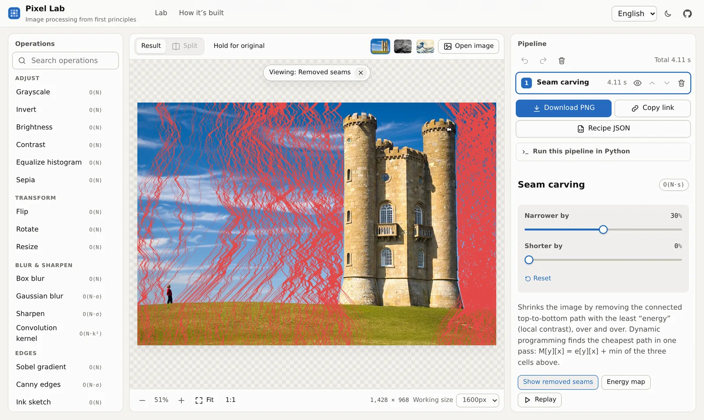
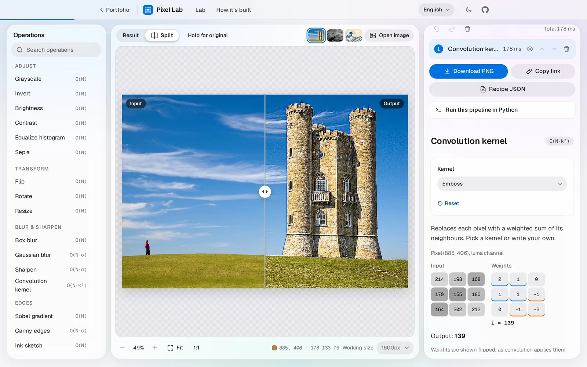
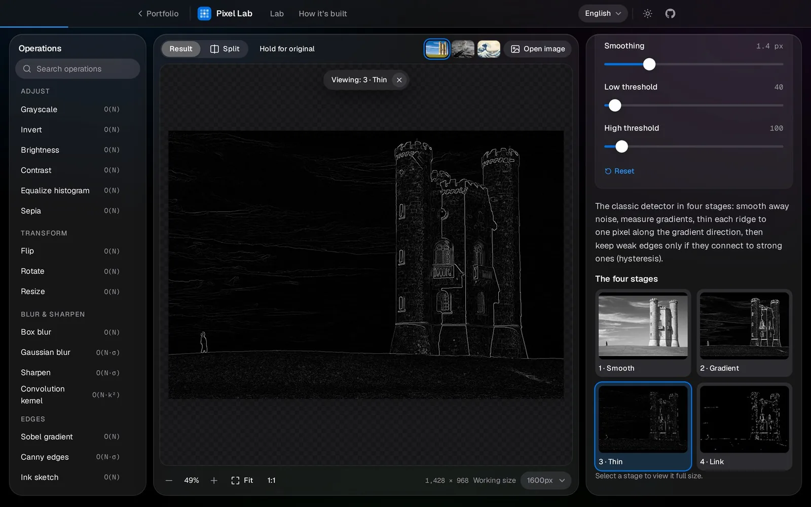
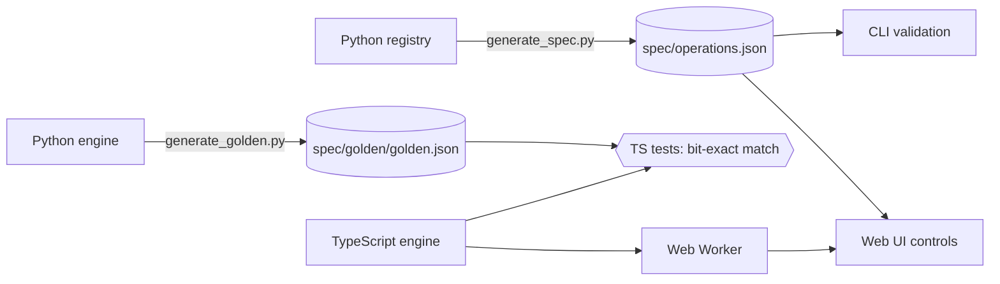

<div align="center">

# Pixel Lab

**Image processing from first principles.** Nineteen algorithms, including seam carving, Canny edge detection and Floyd–Steinberg dithering, hand-written twice: once as a readable pure-Python reference, once as a fast TypeScript engine that runs in your browser. Automated tests prove the two produce **identical pixels**.

[**Try it live →**](https://hasan-jwaied.github.io/image-editor/) &nbsp;·&nbsp; [How it's built](https://hasan-jwaied.github.io/image-editor/#how) &nbsp;·&nbsp; [Python CLI](#python-reference-and-cli)

[](https://github.com/hasan-jwaied/image-editor/actions/workflows/ci.yml)




</div>

## Highlights

- **Every algorithm explained in place.** Point at the image to see the real 3×3 neighbourhood, the (flipped) kernel and the weighted sum; watch the summed-area table's four lookups; step through Canny's four stages; replay the seams that seam carving removes.
- **Measured, not claimed.** A naive 15×15 blur in pure Python took **22.4 s** on a 0.68-megapixel image. A summed-area table brings that to **0.29 s at any radius**, still in pure Python, and to **14 ms** in TypeScript. The lab lets you race the three algorithms in your own browser.
- **Two engines, one answer.** Python generates 93 golden cases; the TypeScript suite must match every pixel exactly. Getting there meant reproducing Python's round-half-to-even rounding and adding floating-point numbers in the same order.
- **One spec drives everything.** Operations are declared once in a Python registry and exported to [`spec/operations.json`](spec/operations.json). The CLI validates against it, the web app builds its controls from it, and a contract test fails if either engine falls out of sync. A pipeline built in the browser can be replayed by the CLI.
- **Private and global.** Nothing is uploaded; there's no server, no analytics, no third-party request. Works offline, on phones, with keyboard only, and in English, Arabic and Hebrew (full right-to-left layout).

<table>
<tr>
<td></td>
<td></td>
</tr>
</table>

## Algorithms

| Category | Operation | Technique | Cost (N = pixels) |
|---|---|---|---|
| Adjust | Grayscale, invert, brightness, contrast | Rec. 601 luma; 256-entry look-up tables | O(N) |
| | Equalize histogram | CDF remapping of luma in YCbCr, so colors don't shift | O(N) |
| | Sepia | 3×3 color matrix | O(N) |
| Transform | Flip, rotate | Index transposition (lossless) | O(N) |
| | Resize | Bilinear interpolation, pixel-centre aligned | O(N) |
| Blur & sharpen | Box blur | Summed-area table: 4 lookups per pixel, any radius | O(N) |
| | Gaussian blur | Separable: horizontal then vertical 1-D pass | O(N·σ) |
| | Sharpen | Unsharp mask | O(N·σ) |
| | Convolution kernel | True convolution (flipped kernel), clamp-to-edge, editable 3×3 | O(N·k²) |
| Edges | Sobel | Gradient magnitude √(Gx² + Gy²) | O(N) |
| | Canny | Smooth → gradient → non-maximum suppression → hysteresis | O(N·σ) |
| | Ink sketch | Adaptive threshold against a summed-area-table local mean | O(N) |
| Stylize | Posterize | Uniform quantization | O(N) |
| | Dither | Floyd–Steinberg error diffusion | O(N) |
| Content-aware | Seam carving | Dynamic programming over a dual-gradient energy map | O(N·seams) |

## How it fits together



- **`python/`** is the reference implementation: a planar image model (each channel is a list of rows of ints), one module per algorithm family, a scriptable CLI and an interactive editor with undo/redo. Pillow is used only to decode and encode files.
- **`web/`** is a React + TypeScript app. The engine mirrors the Python modules on flat `Uint8Array` planes and runs in a Web Worker that caches every step's output, so editing step *k* only recomputes steps *k…n*. Slow runs are superseded or restarted instead of queued, so sliders stay responsive.
- **`spec/`** holds the contracts shared by both: the operation spec, the golden outputs and example recipes.

## Benchmarks

Box blur of a 1000×678 grayscale image. Best of several runs; CPython 3.10 and Node 20 on the same machine. Reproduce with `python python/scripts/benchmark.py photo.jpg && npm --prefix web run bench`.

| Radius (kernel) | v1 script | Python, 2-D convolution | Python, separable | **Python, summed-area table** | TypeScript, separable | **TypeScript, summed-area table** |
|---:|---:|---:|---:|---:|---:|---:|
| 1 (3×3) | 1.45 s | 0.59 s | 0.45 s | **0.28 s** | 26 ms | **17 ms** |
| 4 (9×9) | 8.60 s | 4.50 s | 1.00 s | **0.27 s** | 52 ms | **14 ms** |
| 7 (15×15) | 22.4 s | 12.4 s | 1.65 s | **0.29 s** | 80 ms | **14 ms** |
| 20 (41×41) | — | — | 4.27 s | **0.29 s** | 209 ms | **13 ms** |

Encoding a result for saving went from **3.0 s to 24 ms**: v1 deep-copied the image and called `putpixel` once per pixel, while v2 hands Pillow one byte buffer per channel. Per-operation timings for both engines are in [`bench/`](bench) and on the live page.

## Quick start

### Web app

```bash
cd web
npm install
npm run dev        # http://localhost:5173
```

`npm test` runs the engine tests (including the golden cross-check), `npm run e2e` runs the Playwright smoke and accessibility tests, and `npm run build` produces the standalone static site in `web/dist` (relative asset paths, offline support), which is what GitHub Pages serves.

`npm run build:site` produces the copy embedded in my portfolio at `/lab` (`web/dist-site`: absolute `/lab/` paths, no service worker, canonical and share URLs from `web/.env.site`). The portfolio's `npm run lab:sync` copies it into its `public/lab`. The design follows the portfolio's Apple-style system (same neutrals, accent, glass and navigation bar) and shares its `theme` setting, so light/dark carries over between the two.

### Python reference and CLI

```bash
cd python
python -m venv .venv && source .venv/bin/activate
pip install -e '.[dev]'

pixel-lab list                                              # every operation and its parameters
pixel-lab run photo.jpg -o sketch.png -s grayscale -s canny:sigma=2
pixel-lab run photo.jpg -o out.png --recipe pixel-lab-recipe.json   # exported from the web app
pixel-lab edit photo.jpg                                    # interactive session: undo, redo, history
```

```python
from pixel_lab import load_image, save_image, ops

img = load_image("photo.jpg")
save_image(ops.seam_carve(img, width_percent=30, height_percent=0), "narrow.png")
```

## Testing

| | Python | TypeScript |
|---|---|---|
| Unit and known-value tests | ✓ hand-computed expectations (bilinear weights, Sobel on a step edge, …) | ✓ |
| Property-based tests | ✓ Hypothesis: 4 quarter turns = identity, blurs fix flat images, SAT blur ≡ naive blur, seam DP is optimal vs. brute force, … | |
| Golden outputs | generates and regression-checks 93 cases | **must reproduce every pixel exactly** |
| Shared contracts | spec freshness, example recipes run through the CLI | spec coverage, same recipes parse and run |
| Static checks | ruff, mypy `--strict` | ESLint, `tsc` strict |
| End-to-end | | Playwright on desktop and mobile viewports |

CI runs all of it on every push (Python 3.10–3.13), and the site is deployed to GitHub Pages from `main`.

## Project layout

```
python/            pure-Python reference engine, CLI, tests, spec/golden/benchmark scripts
  src/pixel_lab/   image.py · io.py · registry.py · recipe.py · cli.py · ops/*.py
web/               React + TypeScript app
  src/engine/      TypeScript port of every operation (no dependencies)
  src/worker/      Web Worker with per-step caching
  src/components/  viewer, pipeline, explainers, charts
  tests/  e2e/     Vitest suites, Playwright smoke tests
spec/              operations.json · golden/ · recipes/ (shared by both engines)
bench/             benchmark results used by the README and the site
```

## Design notes

- **Why no NumPy?** The point is to show the algorithms, not a library's. NumPy would make the Python version faster but would hide exactly the loops this project is about. The TypeScript engine is the fast path.
- **Why planar channels?** Most operations are defined per channel. Planar storage means each algorithm is written once, for a single plane, and alpha is carried along only by geometric operations.
- **Convolution vs. correlation.** The convolution operation flips its kernel, as the mathematical definition requires. It makes no difference for symmetric kernels but does for emboss, and the inspector shows the flipped weights.
- **Bit-exactness.** Python's `round` sends halves to the even neighbour; JavaScript's `Math.round` sends them up. The engine uses a `roundHalfEven` helper everywhere Python rounds, and float sums are accumulated in the same order, which is why even the Gaussian blur, whose weights come from each language's own `exp()`, matches exactly.

## Credits

Sample photos: *Broadway Tower* by Newton2, CC BY 2.5, via Wikimedia Commons · *Buzz Aldrin on the Moon* by Neil Armstrong, NASA, public domain · *The Great Wave off Kanagawa* by Katsushika Hokusai, public domain. Seam carving follows Avidan & Shamir, *Seam Carving for Content-Aware Image Resizing* (SIGGRAPH 2007).

Pixel Lab started as a university exercise: a menu-driven script that applied one filter at a time. It was rebuilt from that starting point into what you see here.

## License

[MIT](LICENSE) © 2026 Hasan Jwaied
