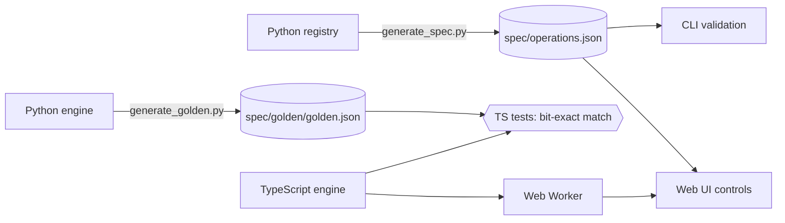

<div align="center">

# Pixel Lab

Nineteen image-processing algorithms (seam carving, Canny edges, Floyd–Steinberg dithering and more) written from scratch twice: a pure-Python reference and a TypeScript engine that runs in the browser. Tests check that both produce the same pixels.

[Live demo](https://hasan-jwaied.github.io/image-editor/) · [How it's built](https://hasan-jwaied.github.io/image-editor/#how) · [Python CLI](#python-reference-and-cli)

[](https://github.com/hasan-jwaied/image-editor/actions/workflows/ci.yml)


</div>

## Features

- Each operation has an explainer: the pixel neighbourhood and kernel under the pointer, the summed-area table lookups, Canny's four stages, the removed seams.
- A 15×15 blur went from 22.4 s in the first version to 0.29 s in pure Python and 14 ms in TypeScript. You can race the blur algorithms on your own machine.
- Python generates 93 golden cases and the TypeScript engine has to match every pixel.
- Everything runs locally: no server, no uploads, no analytics. Works offline and on phones, in English and Hebrew.

<table>
<tr>
<td></td>
<td></td>
</tr>
</table>

## Algorithms

| Category | Operation | Technique | Cost (N = pixels) |
|---|---|---|---|
| Adjust | Grayscale, invert, brightness, contrast | Rec. 601 luma; 256-entry look-up tables | O(N) |
| | Equalize histogram | CDF remapping of luma in YCbCr, so colors don't shift | O(N) |
| | Sepia | 3×3 color matrix | O(N) |
| Transform | Flip, rotate | Index transposition (lossless) | O(N) |
| | Resize | Bilinear interpolation, pixel-centre aligned | O(N) |
| Blur & sharpen | Box blur | Summed-area table: 4 lookups per pixel, any radius | O(N) |
| | Gaussian blur | Separable: horizontal then vertical 1-D pass | O(N·σ) |
| | Sharpen | Unsharp mask | O(N·σ) |
| | Convolution kernel | True convolution (flipped kernel), clamp-to-edge, editable 3×3 | O(N·k²) |
| Edges | Sobel | Gradient magnitude √(Gx² + Gy²) | O(N) |
| | Canny | Smooth → gradient → non-maximum suppression → hysteresis | O(N·σ) |
| | Ink sketch | Adaptive threshold against a summed-area-table local mean | O(N) |
| Stylize | Posterize | Uniform quantization | O(N) |
| | Dither | Floyd–Steinberg error diffusion | O(N) |
| Content-aware | Seam carving | Dynamic programming over a dual-gradient energy map | O(N·seams) |

## How it fits together



- `python/`: the reference engine, CLI and interactive editor. Pillow only reads and writes files.
- `web/`: React + TypeScript. The engine runs in a Web Worker that caches each step, so editing step *k* only reruns steps *k…n*.
- `spec/`: what both sides share. The operation list is generated from the Python registry; the CLI validates against it and the web app builds its controls from it.

## Benchmarks

Box blur of a 1000×678 grayscale image, best of several runs, CPython 3.10 and Node 20 on one machine. Reproduce with `python python/scripts/benchmark.py photo.jpg && npm --prefix web run bench`.

| Radius (kernel) | v1 script | Python, 2-D convolution | Python, separable | **Python, summed-area table** | TypeScript, separable | **TypeScript, summed-area table** |
|---:|---:|---:|---:|---:|---:|---:|
| 1 (3×3) | 1.45 s | 0.59 s | 0.45 s | **0.28 s** | 26 ms | **17 ms** |
| 4 (9×9) | 8.60 s | 4.50 s | 1.00 s | **0.27 s** | 52 ms | **14 ms** |
| 7 (15×15) | 22.4 s | 12.4 s | 1.65 s | **0.29 s** | 80 ms | **14 ms** |
| 20 (41×41) | — | — | 4.27 s | **0.29 s** | 209 ms | **13 ms** |

Saving went from 3.0 s to 24 ms: v1 called `putpixel` once per pixel, v2 hands Pillow one buffer per channel. Per-operation timings are in [`bench/`](bench).

## Quick start

### Web app

```bash
cd web
npm install
npm run dev        # http://localhost:5173
```

`npm test` runs the engine and golden tests, `npm run e2e` the Playwright tests. `npm run build` builds the GitHub Pages site; `npm run build:site` builds the copy my portfolio serves at `/lab`.

### Python reference and CLI

```bash
cd python
python -m venv .venv && source .venv/bin/activate
pip install -e '.[dev]'

pixel-lab list
pixel-lab run photo.jpg -o sketch.png -s grayscale -s canny:sigma=2
pixel-lab run photo.jpg -o out.png --recipe recipe.json   # saved by pixel-lab edit
pixel-lab edit photo.jpg                                    # interactive, with undo/redo
```

```python
from pixel_lab import load_image, save_image, ops

img = load_image("photo.jpg")
save_image(ops.seam_carve(img, width_percent=30, height_percent=0), "narrow.png")
```

## Testing

| | Python | TypeScript |
|---|---|---|
| Unit and known-value tests | ✓ hand-computed expectations (bilinear weights, Sobel on a step edge, …) | ✓ |
| Property-based tests | ✓ Hypothesis: 4 quarter turns = identity, blurs fix flat images, SAT blur ≡ naive blur, seam DP is optimal vs. brute force, … | |
| Golden outputs | generates and regression-checks 93 cases | **must reproduce every pixel exactly** |
| Shared contracts | spec freshness, example recipes run through the CLI | spec coverage, same recipes parse and run |
| Static checks | ruff, mypy `--strict` | ESLint, `tsc` strict |
| End-to-end | | Playwright on desktop and mobile viewports |

CI runs everything on Python 3.10–3.13; `main` deploys to GitHub Pages.

## Project layout

```
python/            pure-Python reference engine, CLI, tests, spec/golden/benchmark scripts
  src/pixel_lab/   image.py · io.py · registry.py · recipe.py · cli.py · ops/*.py
web/               React + TypeScript app
  src/engine/      TypeScript port of every operation (no dependencies)
  src/worker/      Web Worker with per-step caching
  src/components/  viewer, pipeline, explainers, charts
  tests/  e2e/     Vitest suites, Playwright smoke tests
spec/              operations.json · golden/ · recipes/ (shared by both engines)
bench/             benchmark results used by the README and the site
```

## Design notes

- No NumPy: it would hide the loops this project is about. Speed comes from better algorithms and the TypeScript engine.
- Planar channels: most operations work per channel, so each is written once for a single plane. Only geometric operations move alpha.
- The convolution flips its kernel, as the definition says. That matters for asymmetric kernels like emboss.
- Matching pixels exactly: Python's `round` sends halves to even, `Math.round` sends them up, so the TypeScript engine uses its own `roundHalfEven` and adds floats in the same order as Python.

## Credits

Sample photos: *Broadway Tower* by Newton2, CC BY 2.5, via Wikimedia Commons · *Buzz Aldrin on the Moon* by Neil Armstrong, NASA, public domain · *The Great Wave off Kanagawa* by Katsushika Hokusai, public domain. Seam carving follows Avidan & Shamir, *Seam Carving for Content-Aware Image Resizing* (SIGGRAPH 2007).

Pixel Lab started as a university exercise: a menu-driven script that applied one filter at a time.

## License

[MIT](LICENSE) © 2026 Hasan Jwaied
